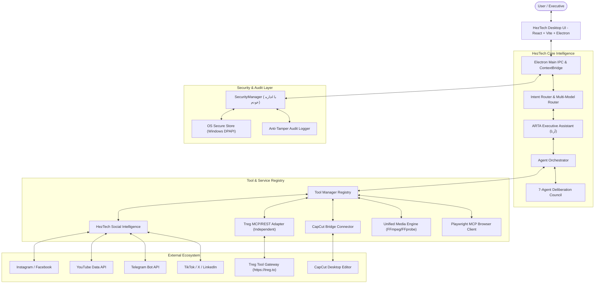

# HezTech (هستک) — Executive Desktop Workspace & Multi-Agent Intelligence Center

<p align="center">
  
  
  
  
  
</p>

> **HezTech** is an executive desktop workspace and multi-agent operating environment designed for high-performance creative direction, media editing, cross-platform social intelligence, and autonomous task orchestration on Microsoft Windows.

---

## ✦ Table of Contents

- [Architectural Overview](#architectural-overview)
- [Core Subsystems](#core-subsystems)
  - [1. ARTA & Multi-Agent Orchestrator](#1-arta--multi-agent-orchestrator)
  - [2. 7-Agent Deliberation Council](#2-7-agent-deliberation-council)
  - [3. HezTech Social Intelligence](#3-heztech-social-intelligence)
  - [4. CapCut Bridge Integration](#4-capcut-bridge-integration)
  - [5. Unified Media Engine](#5-unified-media-engine)
  - [6. Zero-Trust Security Gate](#6-zero-trust-security-gate)
- [Prerequisites & System Requirements](#prerequisites--system-requirements)
- [Installation & Local Setup](#installation--local-setup)
- [Testing & Quality Assurance](#testing--quality-assurance)
- [MCP & Tool Registry Configuration](#mcp--tool-registry-configuration)
- [Ownership & Confidentiality Boundary](#ownership--confidentiality-boundary)
- [License](#license)

---

## ✦ Architectural Overview



---

## ✦ Core Subsystems

### 1. ARTA & Multi-Agent Orchestrator
- **Authoritative Identity:** **ARTA (اَرتا)** is the executive smart assistant inside HezTech. HezTech is the application product name.
- **Dynamic Intent Dispatching:** User requests are categorized into direct conversational queries, mathematical/offline evaluations, or autonomous multi-turn tool missions.
- **Context & Memory:** Cross-session persistent context stored locally in SQLite/JSON vault with domain isolation.

### 2. 7-Agent Deliberation Council
A structured peer-review deliberation mechanism:
1. **Chief System Architect (🏛️):** Structural integrity, domain isolation, and modularity.
2. **Principal Software Engineer (⚡):** IPC correctness, type safety, and runtime fault tolerance.
3. **Chief Security Officer (🛡️):** Zero-trust enforcement, DPAPI credential protection, and absolute veto power.
4. **Scientific Research Lead (🧬):** Fact validation, algorithmic evidence, and documentation audit.
5. **DevOps & Release Lead (🚀):** Packaging integrity, dependency isolation, and process lifecycle.
6. **Red Team Critic (🔍):** Adversarial edge case detection and failure mode stress testing.
7. **Independent Arbiter / Judge (⚖️):** Weighted rubric scoring and binding implementation verdicts.

### 3. HezTech Social Intelligence
A unified social engineering and publishing hub supporting **Instagram**, **Facebook**, **YouTube**, **TikTok**, **X (Twitter)**, **LinkedIn**, and **Telegram**:
- **Social Discovery:** Search trending topics, hashtags, and viral storytelling formulas with platform and language filtering.
- **Competitor Intelligence:** Audit posting frequency, content breakdown, hook patterns, and engagement benchmarks.
- **Content & Hook Intelligence:** 26 scored viral hook formulas, 3-second retention analysis, speaking rate calibration (140 WPM), and script outlining.
- **Social Analytics:** Aggregated metrics, engagement velocity, and report generation saved to local vault.
- **Publishing Assistant:** Pre-flight compliance check (character limits, aspect ratio check) and Human-in-the-Loop approval gate with official fallback upload routing.
- **Treg Integration Adapter:** Connects to the Treg tool catalog (`https://treg.to/mcp/`) as an independent adapter in the Tool Registry layer with strict cost capping (`X-Treg-Route-Max-Cost`) and graceful fallback to native tools.

### 4. CapCut Bridge Integration
Seamless, non-destructive bridge to **CapCut Desktop**:
- Interacts with `C:\Users\Green\openclaw\capcut-bridge-kit` via typed contract dispatcher.
- Reads and parses real on-disk CapCut draft projects (`draft_content.json`).
- Live process guard detecting `CapCut.exe` state and drafts repository without process termination.
- Export timeline edits and microsecond-precise subtitle tracks directly into CapCut draft folders.

### 5. Unified Media Engine
Production-grade, 100% offline local video and audio processing powered by **FFmpeg & FFprobe**:
- **Media Probing:** Streams, codecs, bitrate, dimensions, FPS, and channels inspection.
- **Trimming & Frame Extraction:** Frame-accurate cuts and PNG thumbnail capture without modifying original sources.
- **Silence Remover:** Automated silence interval detection (`silencedetect`) and complex filter trimming.
- **Persian RTL Subtitle Burner:** FriBidi/HarfBuzz shaper support preventing character disconnection or reversal.
- **Aspect Ratio Converter:** Dynamic 16:9 Landscape <-> 9:16 Portrait (Reels/Shorts) with blurred background padding or center crop.
- **Audio Normalizer:** EBU R128 loudness normalization (`loudnorm`) with low-frequency rumble filter (`highpass=80Hz`).
- **Merge Clips:** Concatenation of multiple video files with unified resolution and audio normalization.
- **Standard Presets:** One-click presets for Instagram Reels, YouTube 16:9, YouTube Shorts, Web FastStart, and Master Quality.

### 6. Zero-Trust Security Gate («با اجازه خودم»)
- **Cryptographic Approval Nonces:** Sensitive write operations (external messages, system commands, publishing) require owner approval in the UI.
- **Anti-Tampering Binding:** Any change to recipient, platform, or content invalidates the approval token.
- **DPAPI OS Encryption:** Secrets and tokens are encrypted via Windows DPAPI and stored in `%APPDATA%\HezTech\secure-store\credentials.enc.json`. Tokens are never exposed to renderer code or public git history.
- **Audit Logging:** Every critical action and tool invocation is recorded with UTC timestamp, duration, caller, and status.

---

## ✦ Prerequisites & System Requirements

- **Operating System:** Windows 10 / 11 (64-bit)
- **Node.js:** v22.x or v24.x LTS
- **Python:** v3.10+ (for CapCut Bridge Kit and local contracts)
- **FFmpeg & FFprobe:** Must be available on system PATH or configured via `HEZTECH_FFMPEG` / `HEZTECH_FFPROBE`
- **CapCut Desktop (Optional):** For live project import/export

---

## ✦ Installation & Local Setup

1. **Clone the repository:**
   ```powershell
   git clone https://github.com/Hesaar-Studio/heztech.git
   cd heztech
   ```

2. **Install dependencies:**
   ```powershell
   npm install
   npm --prefix heztech-frontend install
   ```

3. **Configure environment variables (Optional):**
   ```powershell
   Copy-Item .env.example .env
   ```

4. **Build the frontend user interface:**
   ```powershell
   npm run build:ui
   ```

5. **Launch HezTech in development mode:**
   ```powershell
   npm start
   ```

6. **Package standalone Windows installer:**
   ```powershell
   npm run dist
   ```

---

## ✦ Testing & Quality Assurance

Run the comprehensive test suites to verify system integrity:

```powershell
# 1. Run core agent tools, live session & Persian chat lifecycle tests
npm test

# 2. Run identity authority and 7-agent council deliberation tests
npm run test:identity

# 3. Run Social Intelligence, Treg adapter & Media Studio tests
node --test test/social-and-media-suite.test.cjs
```

---

## ✦ Ownership & Confidentiality Boundary

- **HezTech:** Open-Source Desktop Application under Hesaart Studio (MIT License).
- **CapCut Bridge Kit:** Open-Source Bridge Library under Hesaart Studio (MIT License).
- **D&T AI Tech:** Strictly proprietary and confidential. No internal code, proprietary schemas, secrets, or internal server assets from D&T AI Tech are distributed within this repository.

---

## ✦ License

This project is licensed under the [MIT License](LICENSE) — Copyright (c) 2026 Hesaart Studio.
